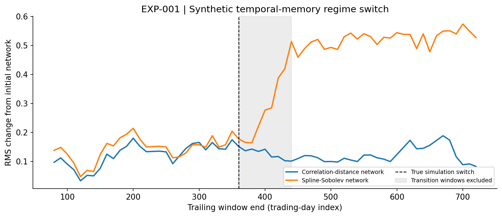
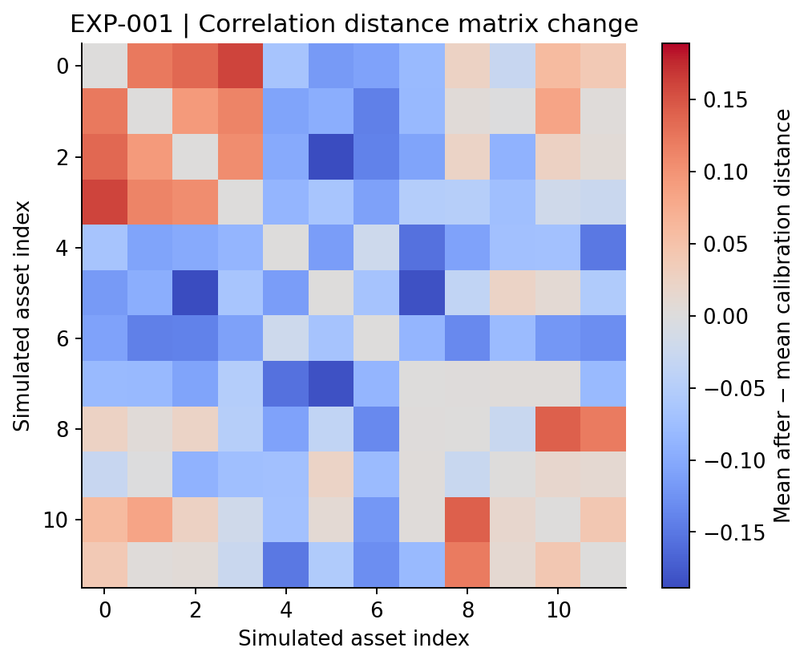
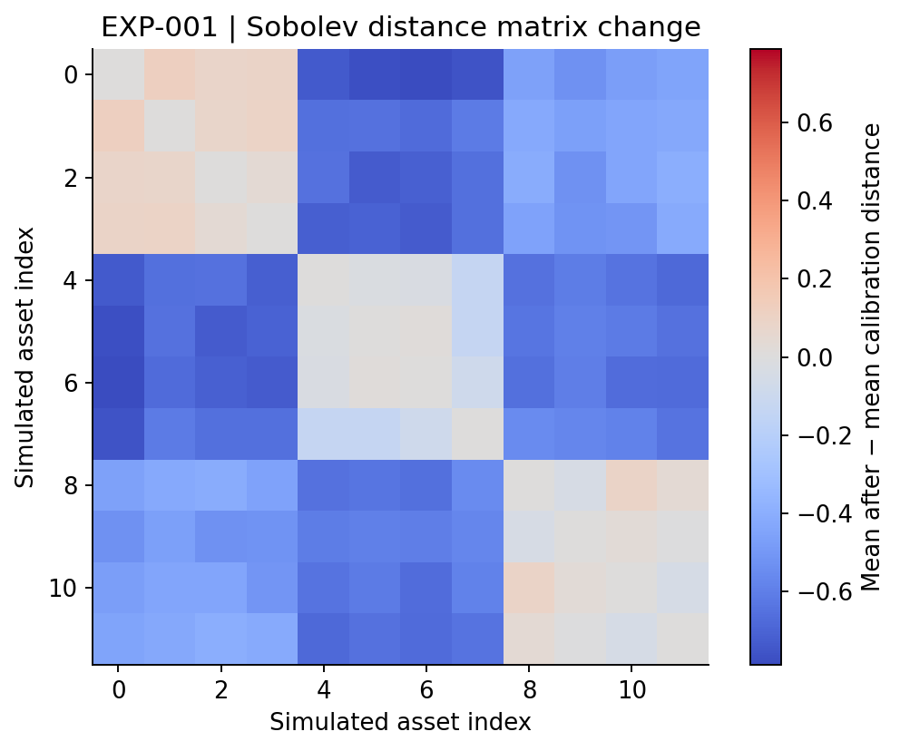
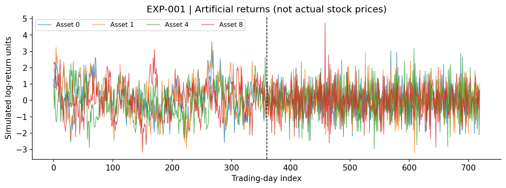

# EXP-001 — Synthetic temporal-memory regime switch

**Status:** Executable synthetic pilot. This page includes the mathematical design; computed, archived runs are appended below after the experiment has actually executed. **Not evidence of outperformance on market data.**

## Research question and competing explanations

Can a derivative-sensitive Hilbert-space metric register a change in serial dependence when the population contemporaneous Pearson-correlation matrix remains unchanged?

- **Null / correlation baseline:** The contemporaneous population correlation structure is invariant. Estimated rolling correlation-distance networks will still fluctuate due to finite samples.
- **Alternative / Sobolev hypothesis:** The temporal roughness of group factors changes with the AR coefficient. An H1 metric can respond to temporal differences even with fixed contemporaneous covariance.
- **Important rival:** Ordinary lagged autocorrelation or time-series spectral estimators may recover the shift more simply. The pilot does **not** outperform or compare against them yet.

## Data generating process

Three independent, unit-variance group factors follow stationary AR(1) dynamics in each segment:

$$
F_{g,t}=\phi_s F_{g,t-1}+\sqrt{1-\phi_s^2}\,\eta_{g,t},\qquad
r_{i,t}=\sqrt{a}\,F_{g(i),t}+\sqrt{1-a}\,\epsilon_{i,t}.
$$

Here $\eta$ and $\epsilon$ are independent standard Gaussian innovations, $a=0.70$, $\phi_0=0.82$, $\phi_1=-0.65$; there are 12 assets and three equal groups. Group factor values restart from the stationary distribution at the boundary. For assets $i\ne j$,

$$
\operatorname{Corr}(r_{i,t},r_{j,t})=
\begin{cases}
a,&g(i)=g(j),\\0,&g(i)\ne g(j),
\end{cases}
$$

regardless of $\phi_s$. But serial covariance depends on $\phi_s$:

$$
\operatorname{Cov}(r_{i,t},r_{j,t-1})=a\phi_s\,\boldsymbol{1}\{g(i)=g(j)\},\quad i\ne j,
$$

away from the boundary. This makes the regimes distinguishable by lagged correlation—an intentional negative-control baseline to add next.

## Analytical prediction before computation

The simplest raw daily-difference analogue of the Sobolev derivative term has an exact expectation. If $Y_t=r_{i,t}-r_{j,t}$ and $\Delta Y_t=Y_t-Y_{t-1}$, stationarity inside each regime gives

$$
\mathbb E[(\Delta Y_t)^2]=2\{\operatorname{Var}(Y_t)-\operatorname{Cov}(Y_t,Y_{t-1})\}.
$$

For distinct assets in the same group this equals $4(1-a)=1.20$ in both regimes. For assets in different groups it equals $4(1-a\phi_s)$, changing from $1.704$ before the switch to $5.82$ afterward. Thus a derivative-aware distance is **expected** to change without a population contemporaneous-correlation change, although smoothing alters exact finite-window values. Ordinary lagged autocorrelation or frequency-domain analysis captures the same mechanism. See [Proposition 3](../mathematics/001-hilbert_metrics.md).

## Functional representation and objective

For a trailing window $w$ of standardized daily returns $z_i(t)$, fit common cubic spline basis coefficients:

$$
\widehat f_{i,w}(u)=\sum_{k=1}^K\beta_{i,k,w}B_k(u),\qquad
\widehat\beta_i=\arg\min_\beta \|z_i-B\beta\|_2^2+\gamma\|D_2\beta\|_2^2.
$$

With normalized $u\in[0,1]$ and trading-day derivative $\partial_t=\partial_u/(W-1)$, define

$$
d_{H^1_\lambda}(i,j\mid w)^2=\int_0^1
\left[(\widehat f_i-\widehat f_j)^2+
\lambda\left(\partial_t\widehat f_i-\partial_t\widehat f_j\right)^2\right]du.
$$

As $\lambda>0$ this is a genuine metric on distinct fitted functions, but only a **pseudometric on raw paths** because penalized spline projection can map different observations to one function. Baseline distance $d_\rho=\sqrt{2(1-\widehat\rho_{ij,w})}$. We compare windowwise distance matrices rather than claiming causal or directional dependence.

To summarize a window we use held-out edge deviation from the **calibration-period mean distance matrix**:

$$
S_w=\left[\frac{2}{n(n-1)}\sum_{i<j}(d_{ij,w}-\overline d_{ij,\mathrm{cal}})^2\right]^{1/2}.
$$

Calibration: windows ending at or before half the true simulation boundary. Evaluation: later wholly pre-switch and wholly post-switch windows; windows overlapping the switch are excluded. This protocol uses the known synthetic boundary to **define evaluation segments** and is not a deployable unsupervised detector. Exploratory AUROC compares the score distributions in these two segments.

## Figure plan and reproduction status

| Filename | Content | Status |
|---|---|---|
| `network_deviation.png` / `.svg` | Two rolling network deviation scores and synthetic regime boundary | Created by `--publish` |
| `distance_delta_correlation.png` / `.svg` | Change in correlation-distance matrix | Created by `--publish` |
| `distance_delta_sobolev.png` / `.svg` | Change in Sobolev-distance matrix | Created by `--publish` |
| `sample_synthetic_returns.png` / `.svg` | Representative artificial asset returns | Created by `--publish` |

The actual image links are appended only after their PNG/SVG files exist.

## Reproduction

From repository root: `python market_geometry/code/001-temporal_regime_pilot/run.py --publish`.

This makes a new timestamped run and appends its actual numerical summary and figure links below. To smoke-test without changing the research record use `--quick`. Generated results are immutable; do not conflate multiple seeds or edit older run sections.

## Interpretation and limits

- Contemporaneous *population* correlation is held fixed; **finite-sample** correlation estimates need not match exactly.
- The synthetic shift changes AR memory. This experiment is **not** proof that spline geometry is better than conventional time-series metrics, nor that it identifies nonlinear or causal dependence.
- Overlapping rolling windows are statistically dependent. Single-seed AUROC cannot support significance, generalization, or superiority claims.
- Derivative features can amplify noise, and spline smoothing determines which temporal frequencies survive.
- Needed: repeated seeds, nested train/validation/test without oracle event selection, leading lagged-correlation and spectral baselines, financial data with survivorship-bias checks, and transaction-free non-predictive regime evaluation before any trading claims.

<!-- AUTOMATED RUNS BELOW: append without rewriting previous scientific records. -->

### Executed run `run_20261018T212747930389Z_s20261018` (synthetic pilot)

Seed `20261018`; training-only calibration windows `11`; held-out pre/post windows `18`/`29`.

Exploratory AUROC: correlation `0.249`, spline-Sobolev `1.000`. **Single seeded simulation; no statistical claim.**

The panel is simulated; market factors change temporal persistence but retain the same population contemporaneous covariance.

The scores summarize distance-matrix deviation; they are not causal dependence scores or trading forecasts.

Archived numerical results: [`summary.json`](../../results/001-temporal_regime_pilot/runs/run_20261018T212747930389Z_s20261018/summary.json), [`window_scores.csv`](../../results/001-temporal_regime_pilot/runs/run_20261018T212747930389Z_s20261018/window_scores.csv), [`NPZ`](../../results/001-temporal_regime_pilot/runs/run_20261018T212747930389Z_s20261018/synthetic_panel_and_distances.npz), [`SHA-256 manifest`](../../results/001-temporal_regime_pilot/runs/run_20261018T212747930389Z_s20261018/sha256_manifest.json).

**Figures (generated, not placeholders):**

