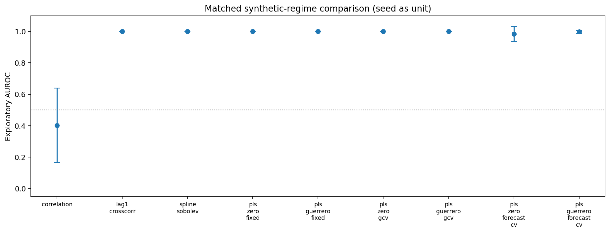
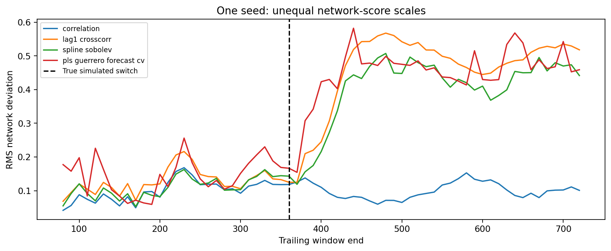
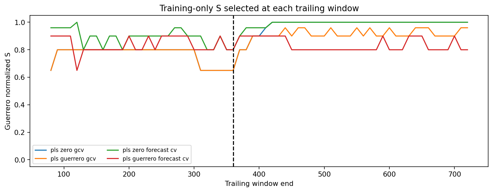

# EXP-002 — Guerrero PLS smoothing versus spline-Sobolev networks

**Status:** Executable experiment; see the appended archived run(s) for actual findings. This is exploratory synthetic work, not evidence of investment value.

## Question and hypothesis

Does *how* we estimate a smooth return path affect the detection of a constructed temporal-memory regime switch? Can Guerrero (2007) mean-centered penalized least squares with normalized smoothness parameter $S$ improve over the fixed B-spline fit of EXP-001, and how does either compare with lag-one cross-correlation?

Our original [Trend-Estimation](https://github.com/heri-espino/Trend-Estimation) already studies this PLS formulation, its endpoints, $S$-index, GCV and historical forecast-directed smoothness selectors. **These are existing methods, not new mathematical inventions here.** The only new question is whether they are useful *as functional representations for time-varying market graphs*.

## Mathematics

For a trailing window of length $L$, let $y_i\in\mathbb R^L$ be asset $i$'s returns and $D_2\in\mathbb R^{(L-2)\times L}$ the consecutive second difference operator. Given fixed $\lambda\ge0$ and $\mu$, define:

$$
\widehat\tau_i=\mathop{\arg\min}_{\tau\in\mathbb R^L}
\left\{\|y_i-\tau\|_2^2+\lambda\|D_2\tau-\mu\mathbf1\|_2^2\right\}.
$$

Define $H_\lambda=(I+\lambda D_2^\top D_2)^{-1}$ and $p_j=\binom{j}{2}$ for $j=0,\ldots,L-1$; then $D_2p=\mathbf1$ and

$$
\widehat\tau_i=H_\lambda y_i+\mu (I-H_\lambda)p.
$$

For the **Guerrero plug-in** mode, $\widehat\mu_i^G=(L-2)^{-1}\mathbf1^\top D_2y_i$, calculated inside each observed window. For **zero** mode, $\mu=0$. We use the normalized coordinate from Trend-Estimation:

$$
S(\lambda)=\frac{L-\operatorname{tr}(H_\lambda)}{L-2}\in[0,1], \qquad
S(0)=0,\quad S(\infty)=1.
$$

At $S=1$ the code computes the exact two-dimensional null-space projection of $D_2$, plus the affine mean-loading term where applicable; it does not numerically invert an arbitrarily large matrix.

Two **separate** questions must not be conflated: (i) estimate $\mu$ via Guerrero's observed-difference formula; (ii) select $S$ via fixed configuration, GCV, or a completed historical forecast objective. Guerrero's index **does not prescribe** any one of these selectors.

**GCV:** For each candidate $S$, evaluate average squared reconstruction error divided by $[1-\mathrm{edf}/L]^2$. For plug-in $\mu$, the effective linear smoother is $A=H+bc^\top$, with $b=(I-H)p$ and $c=D_2^\top\mathbf1/(L-2)$, so $\operatorname{edf}=\operatorname{tr}H+c^\top b$. Without plug-in, $\operatorname{edf}=\operatorname{tr}H$. Ordinary GCV is **not justified as an unbiased selector when returns are serially correlated**.

**Historical one-step forecast CV:** At each trailing outer window, use only its *raw* observed returns. For historical origins $t$ inside that window, fit a length-$40$ training prefix $x_t$ and extrapolate via

$$
\widehat y_{i,t+1}(S)=2\widehat\tau_{i,t}-\widehat\tau_{i,t-1}+\widehat\mu_{i,t},
\qquad
F(S)=\frac{1}{|\mathcal T|N}\sum_{t\in\mathcal T}\sum_{i=1}^N(y_{i,t+1}-\widehat y_{i,t+1}(S))^2.
$$

The $\widehat\mu$ term equals zero in zero mode. Indices $t+1$ are historical, **completed** relative to the current outer trailing window; no final evaluation future is used. Crucially, the selector operates on **raw returns**, not pre-standardized whole-window returns: normalizing by the entire window inside the inner CV folds would leak each fold's target into its training transform. All assets share a predeclared grid and a single selected $S$ in each window; the same grid and origins are used for zero and Guerrero-mean modes.

**Geometry:** After selecting $S$ using raw training-only returns, we standardize each already-observed trailing asset window and fit its PLS curve. The discrete Hilbert–Sobolev feature metric is

$$
\widehat d_{ij}^2=\frac1L\sum_{t=1}^{L}(\widehat\tau_{it}-\widehat\tau_{jt})^2
+\frac\eta{L-1}\sum_{t=1}^{L-1}
[(\widehat\tau_{i,t+1}-\widehat\tau_{it})-(\widehat\tau_{j,t+1}-\widehat\tau_{jt})]^2,
\qquad\eta=0.75.
$$

This discrete-grid norm is **not numerically identical** to the continuous B-spline quadrature used in EXP-001; compare whole pipelines, not interpret their metric values as identically scaled. Correlation uses $\sqrt{2(1-\widehat\rho)}$. The lagged baseline uses the **signed**, symmetrized one-step cross-correlations $\frac12[\rho(r_{it},r_{j,t-1})+\rho(r_{jt},r_{i,t-1})]$ as edge *features*, not as a metric.

At a rolling window $w$, score each method's deviation from its own first-period reference network, computed from the same pre-change calibration windows. AUROC classifies strictly pre-change versus fully post-change windows, excluding transition-overlap windows; the change location comes from the simulator, never from a deployable detection algorithm.

## Experiment design and baselines

- Matched synthetic panels from EXP-001: 12 assets, three groups, same covariance but AR factor persistence changes from $0.82$ to $-0.65$ halfway through 720 days; variance is stationary by construction.
- Methods: Pearson, signed lag-one cross-correlation, B-spline Sobolev, and PLS with zero or Guerrero-plug-in mean, each under fixed $S=0.5$, GCV-selected $S$, or completed forecast-CV-selected $S$. **Nine methods total.**
- Fixed $S$ candidate grid: `0, .1, .2, .35, .5, .65, .8, .9, .96, 1`; second differences $d=2$; outer window $L=80$; stride 10; inner CV width 40, stride 5.
- Same calibration, pre/post splits across methods; overlap between adjacent windows makes them dependent. Independent **simulation seeds**, not windows, are the unit for variation summaries.
- Publication readiness requires larger pre-registered seed campaigns, frequency-domain baselines, independent real data, multiple regimes (including no-change), out-of-time calibration, stability tests, and uncertainty accounting for dependence and multiple testing.

## Figure plan and reproduction status

| Figure | Meaning | Generation |
|---|---|---|
| `seed_level_comparison.png/.svg` | Method AUROC means and between-seed SD | When `--publish` executes |
| `network_scores_first_seed.png/.svg` | Selected network deviations for one seed | When `--publish` executes |
| `selected_s_first_seed.png/.svg` | Training-only selected $S$ over time | When `--publish` executes |

No figure links are inserted before the corresponding PNG/SVG actually exists. Run `python market_geometry/code/002-guerrero_smoothing/run.py --quick` for validation or `--publish --seeds 12` for immutable numerical and image evidence.

## Known limitations and falsifiable predictions

1. The lag-one baseline should detect a reversal in common-factor persistence; **equal or superior lagged baseline performance would weaken our claim** that Hilbert geometry adds information.
2. PLS smoothing on daily returns can erase the very serial fluctuations being investigated; the zero-mean model may differ meaningfully from Guerrero's plug-in trend.
3. Forecast-optimal smoothness need not be best for regime detection; no selection rule has used held-out classification labels, by design.
4. Single-family Gaussian AR simulation cannot establish market utility. The true switch is used to score known regimes, not to train or tune the methods.
5. Guerrero (2007) is cited as a source of classical PLS smoothness, not the author of the particular chronological forecast-CV selection protocol developed in the user's Trend-Estimation research.

**Reference:** Guerrero, V. M. (2007). *Time series smoothing by penalized least squares*. Statistics & Probability Letters 77(12), 1225–1234, https://doi.org/10.1016/j.spl.2007.03.006.

### Completed exploratory run: `run_20261018T214129777862Z_s20261019_n12`

Synthetic independent seeds: **12** (20261019–20261030). This is **not** independent financial validation, nor a claim of superiority.

| Method | Mean AUROC | Between-seed SD |
|---|---:|---:|
| correlation | 0.403 | 0.235 |
| lag1_crosscorr | 1.000 | 0.000 |
| spline_sobolev | 1.000 | 0.000 |
| pls_zero_fixed | 1.000 | 0.000 |
| pls_guerrero_fixed | 1.000 | 0.000 |
| pls_zero_gcv | 1.000 | 0.000 |
| pls_guerrero_gcv | 1.000 | 0.001 |
| pls_zero_forecast_cv | 0.983 | 0.048 |
| pls_guerrero_forecast_cv | 0.997 | 0.009 |

[Numeric summary](../../results/002-guerrero_smoothing/runs/run_20261018T214129777862Z_s20261019_n12/summary.json) · [Seed-level CSV](../../results/002-guerrero_smoothing/runs/run_20261018T214129777862Z_s20261019_n12/seed_level_auroc.csv) · [Selected S](../../results/002-guerrero_smoothing/runs/run_20261018T214129777862Z_s20261019_n12/selected_s_first_seed.csv) · [SHA-256 manifest](../../results/002-guerrero_smoothing/runs/run_20261018T214129777862Z_s20261019_n12/sha256_manifest.json).

**Interpretation must consider the signed lag-one comparator.** AUROC scores on overlapping windows are descriptive, not independent tests.

### Scientific interpretation of the archived 12-seed pilot

This specific simulator imposes a large change in AR persistence from $+0.82$ to $-0.65$ with unchanged contemporaneous population covariance. Every one of the 12 seed-level lag-one network evaluations achieves AUROC 1.000, as do the original spline-Sobolev and several PLS alternatives. **The outcome is a ceiling effect for an easy alternative-versus-null distinction, not evidence of an original detector or an optimal smoothness selection rule.** Forecast-CV and GCV also select different $S$ trajectories; these are useful diagnostics, not automatic confirmation of performance. Next simulations must sweep weaker changes, vary the true regime mechanisms, test no-change false positives and add power-spectral baselines under a design fixed before analysis.
