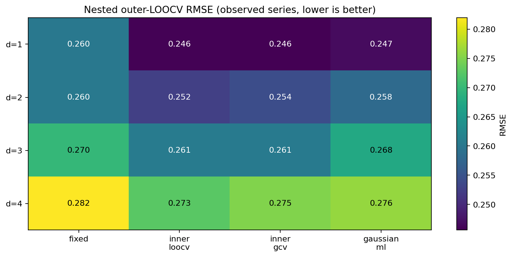
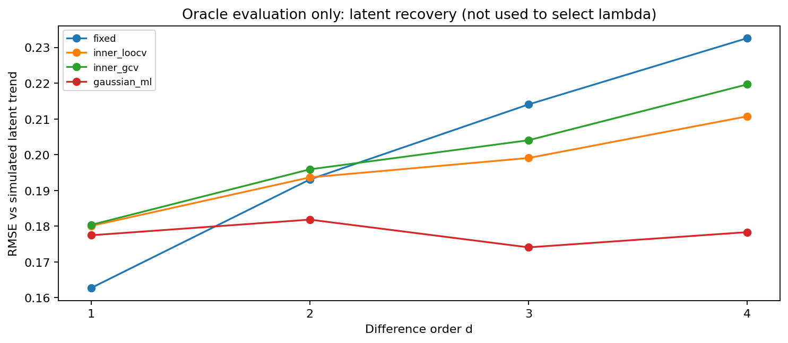
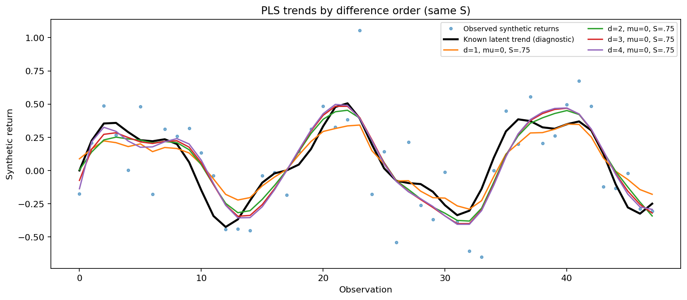
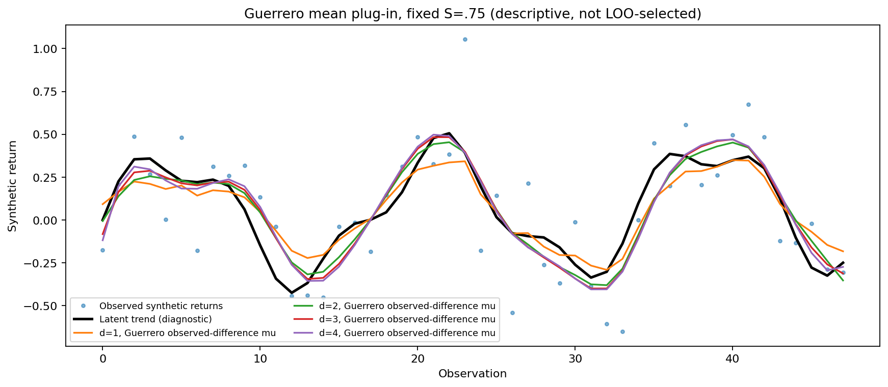

# EXP-003 — Finite-difference order, nested LOOCV and Gaussian variance-ratio ML

**Status:** prospective methodology with executed exploratory simulations only after a run is archived below. Not a published result. Guerrero (2007) developed PLS estimation with an order-\(d\) difference mean and a *controlled smoothness index*. The profile ML comparator here is our implementation of a standard Gaussian variance-component model based on that stochastic setup; do **not** attribute this selector to Guerrero without checking the full paper.

## Question

Do different finite-difference orders \(d=1,2,3,4\) change the estimated return trend, the held-out-observation RMSE and the functional geometry? How does a prespecified smoothness percentage compare with inner LOOCV, GCV and Gaussian likelihood selection of \(\lambda\)?

## Mathematics: differences and smoothing

For a length-\(n\) series \(y\) observed on a regular grid, choose integer \(1\le d<n\), \(\lambda\ge0\), and reference mean \(\mu\):

$$
D_d=\Delta^d\in\mathbb R^{(n-d)\times n},\qquad
\widehat\tau_{\lambda,d,\mu}=\arg\min_\tau\big\{\|y-\tau\|_2^2+\lambda\|D_d\tau-\mu\mathbf1\|_2^2\big\}.
$$

Define \(Q_d=D_d^\top D_d\) and \(H_{\lambda,d}=(I+\lambda Q_d)^{-1}\). For \(D_dp_d=\mathbf1\), \(p_{d,j}=\binom jd\), the exact solution is

$$
\widehat\tau_{\lambda,d,\mu}=H_{\lambda,d}y+\mu(I-H_{\lambda,d})p_d.
$$

The controlled coordinate used in Trend-Estimation is \(S=(n-\operatorname{tr}H_{\lambda,d})/(n-d)\in[0,1]\) for \(d\ge1\). It is a monotone coordinate of \(\lambda\), **not an estimator of \(\lambda\)**. At \(\lambda\to\infty\) and \(\mu=0\), the trend projects onto polynomials of degree at most \(d-1\). With \(\mu\ne0\), the limiting trend can contain a degree-\(d\) term.

- \(d=1\): penalizes first differences, constant limiting trend for zero \(\mu\).
- \(d=2\): penalizes curvature (second differences), linear limiting trend for zero \(\mu\).
- \(d=3\): penalizes changes in curvature, quadratic limiting trend for zero \(\mu\).
- \(d=4\): penalizes fourth differences, cubic limiting trend for zero \(\mu\).

Higher orders are possible mathematically, but have larger near-zero eigenvalue conditioning problems and may overfit high-frequency noise; testing them is not necessarily useful.

## Outer and nested leave-one-out evaluation

For a *fixed* linear smoother \(H\), the leave-one-out residual at observation \(j\) is

$$
e_j^{(-j)}=\frac{y_j-(Hy)_j}{1-H_{jj}}.
$$

For evaluating a method that selects \(\lambda\), using the **same** LOO errors to both choose \(\lambda\) and assess its RMSE would give an optimistic result. Therefore EXP-003 holds out observation \(j\), selects smoothness on the other \(n-1\) observations, refits, and predicts \(y_j\). A second deletion of \(i\ne j\) within the training sample can be computed exactly using the original fixed-\(H\) hat matrix:

$$
e_i^{(-i,-j)}=\frac{(1-H_{jj})e_i+H_{ij}e_j}{(1-H_{ii})(1-H_{jj})-H_{ij}^2},\quad e=y-Hy.
$$

Thus each outer fold's inner LOOCV selection does not use \(y_j\) in its fitted predictions or chosen smoothness even though the computational identity is written using full-vector \(e\). Direct masked refits are used as independent unit-test comparisons. Internal GCV also uses only the \(n-1\) retained observations. A fixed \(S\) is specified before seeing the data.

**Target:** \(\mathrm{RMSE}_{\mathrm{outerLOO}}=\sqrt{n^{-1}\sum_j(y_j-\widehat y_j^{(-j)})^2}\) measures **imputation / reconstruction**. It is **not** future return prediction; use chronological blocked/rolling-origin CV for forecasting and network transitions. Because these LOO folds overlap, they are not independent statistical replicates.

## Gaussian likelihood from the stochastic PLS specification (our comparator)

Under independent Gaussian errors,

$$
y=\tau+\eta,\qquad D_d\tau=\mu\mathbf1+\varepsilon,
\qquad \eta\sim N(0,\sigma_\eta^2 I),\quad\varepsilon\sim N(0,\sigma_\varepsilon^2 I),\quad
\lambda=\frac{\sigma_\eta^2}{\sigma_\varepsilon^2}.
$$

The *differenced observations* \(z=D_dy\) have covariance

$$
\operatorname{Cov}(z)=\sigma_\varepsilon^2C_\lambda,\quad
C_\lambda=I+\lambda D_dD_d^\top,
\quad \mathbb Ez=\mu\mathbf1.
$$

For \(m\) available completed differences, profile out the positive scale \(\sigma_\varepsilon^2\), with \(\mu=0\) in this first exact matched comparison. Up to an additive constant, the negative twice-profile-loglikelihood is

$$
J_{ML}(\lambda)=m\log\left(\frac{z^\top C_\lambda^{-1}z}{m}\right)+\log|C_\lambda|,
\qquad \widehat\lambda_{ML}=\arg\min_{\lambda\in[e^{-12},e^{16}]}J_{ML}(\lambda).
$$

**Nested omission:** for each outer heldout \(j\), exclude every row of \(D_d\) that uses \(y_j\), then optimize the likelihood of these valid completed differences. This is a valid marginal likelihood of the retained contrasts but may discard information and is not a fully efficient missing-data state-space ML estimator. Boundary selections are counted. Gaussian iid assumptions fail in the AR(1)-noise scenario, deliberately included as a stress test. The same \(\mu=0\) PLS estimator is used for all four selection rules, avoiding confounding the choice of mean with the choice of \(\lambda\). A separate gallery fits Guerrero's **observed** \(\widehat\mu_G=\operatorname{mean}(D_dy)\) for descriptive comparison only (not assigned a nested LOO score).

## Source and novelty audit

- Victor M. Guerrero (2007), *Time series smoothing by penalized least squares*, **Statistics & Probability Letters** 77(12), 1225–1234, DOI [10.1016/j.spl.2007.03.006](https://doi.org/10.1016/j.spl.2007.03.006). Publisher abstract and sections confirm the smoothness index and variance-ratio stochastic interpretation. The publication has *not* been verified to propose the Gaussian ML selector in this experiment.
- Related comparator: Daniela Cortés-Toto, Víctor M. Guerrero and Hortensia J. Reyes, *Trend smoothness achieved by penalized least squares with the smoothing parameter chosen by optimality criteria*, **Communications in Statistics—Simulation and Computation** (2017), DOI [10.1080/03610918.2015.1005236](https://doi.org/10.1080/03610918.2015.1005236). Includes GCV/CV-type selection.
- The user's own [Trend-Estimation](https://github.com/heri-espino/Trend-Estimation) contains the Guerrero plugin-mean derivation, spectral EDF, and chronological forecast-validation protocols. This experiment implements an independent, explicitly limited comparison; it does **not** claim ML, LOOCV or PLS are original.

## Figure plan

| Output | Status before execution |
|---|---|
| Smooth trends for d=1..4 at matched S and µ=0 | Planned; populated by actual archive |
| Guerrero observed-difference µ gallery, d=1..4 | Planned; descriptive only |
| Outer nested LOOCV observed RMSE by d and selector | Planned; populated by actual archive |
| Oracle latent-trend recovery error | Planned; evaluation diagnostic only |

## Planned next research extension

Connect the selected smooth trend functions to Hilbert-space and Sobolev distances for the *same* held-out market-regime protocol. A lower LOOCV reconstruction RMSE does not logically imply a better market-regime detection score. Compare the two outcomes independently; add forecasting CV as a third distinct objective.

### Completed exploratory run `run_20261018T221417632183Z_s20261020_n4`

4 independent seeds × 4 scenarios × 2 noise designs; 48 observations per synthetic series. This is exploratory and cannot establish which differencing order works best on real stocks.

| Difference order | Fixed S | Nested inner LOOCV | Inner GCV | Gaussian profile ML |
|---|---:|---:|---:|---:|
| d=1 | 0.2602 | 0.2458 | 0.2456 | 0.2467 |
| d=2 | 0.2603 | 0.2525 | 0.2543 | 0.2581 |
| d=3 | 0.2699 | 0.2608 | 0.2606 | 0.2676 |
| d=4 | 0.2820 | 0.2727 | 0.2751 | 0.2762 |

Values are **nested outer-LOOCV reconstruction RMSE** for noisy observed samples. They are not future forecasting RMSE. The Gaussian likelihood was derived from the 2007 stochastic specification and is *not* presented as Guerrero's own original lambda-selection rule. No method was selected using latent truth.

[Summary](../../results/003-order_lambda_loocv/runs/run_20261018T221417632183Z_s20261020_n4/summary.json) · [Seed-scenario CSV](../../results/003-order_lambda_loocv/runs/run_20261018T221417632183Z_s20261020_n4/seed_scenario_level.csv) · [Held-out predictions](../../results/003-order_lambda_loocv/runs/run_20261018T221417632183Z_s20261020_n4/one_panel_loo_predictions.csv) · [SHA-256 manifest](../../results/003-order_lambda_loocv/runs/run_20261018T221417632183Z_s20261020_n4/sha256_manifest.json).

### Completed exploratory run `run_20261018T221759917877Z_s20261020_n4`

4 independent seeds × 4 scenarios × 2 noise designs; 48 observations per synthetic series. This is exploratory and cannot establish which differencing order works best on real stocks.

| Difference order | Fixed S | Nested inner LOOCV | Inner GCV | Gaussian profile ML |
|---|---:|---:|---:|---:|
| d=1 | 0.2602 | 0.2458 | 0.2456 | 0.2467 |
| d=2 | 0.2603 | 0.2525 | 0.2543 | 0.2581 |
| d=3 | 0.2699 | 0.2608 | 0.2606 | 0.2675 |
| d=4 | 0.2820 | 0.2727 | 0.2751 | 0.2761 |

Values are **nested outer-LOOCV reconstruction RMSE** for noisy observed samples. They are not future forecasting RMSE. The Gaussian likelihood was derived from the 2007 stochastic specification and is *not* presented as Guerrero's own original lambda-selection rule. No method was selected using latent truth.

[Summary](../../results/003-order_lambda_loocv/runs/run_20261018T221759917877Z_s20261020_n4/summary.json) · [Seed-scenario CSV](../../results/003-order_lambda_loocv/runs/run_20261018T221759917877Z_s20261020_n4/seed_scenario_level.csv) · [Held-out predictions](../../results/003-order_lambda_loocv/runs/run_20261018T221759917877Z_s20261020_n4/one_panel_loo_predictions.csv) · [SHA-256 manifest](../../results/003-order_lambda_loocv/runs/run_20261018T221759917877Z_s20261020_n4/sha256_manifest.json).

**Numerical refinement notice:** The newer `run_20261018T221759917877Z_s20261020_n4` archive uses a more comprehensive candidate-minima search for the Gaussian likelihood. The preceding `run_20261018T221417632183Z_s20261020_n4` is preserved as historical evidence; do not silently merge its ML results with the updated run. The latest numeric results are those of the *second* run.

**Warning on boundary ML estimates:** The best likelihood may occur at the prespecified log-lambda bounds. Such estimates indicate weak variance-ratio identification or model misspecification and are recorded under `n_ml_boundary_total` in the summary rather than hidden.
