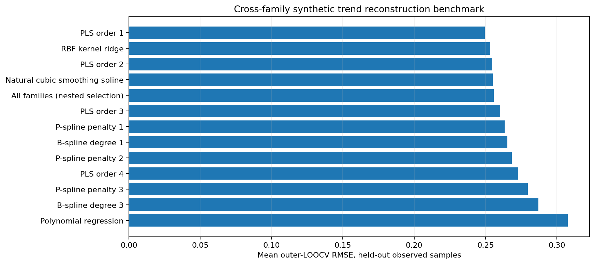
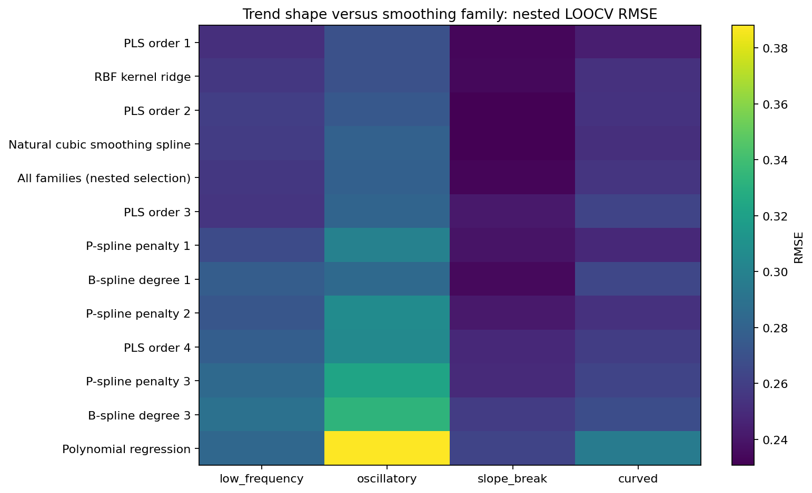
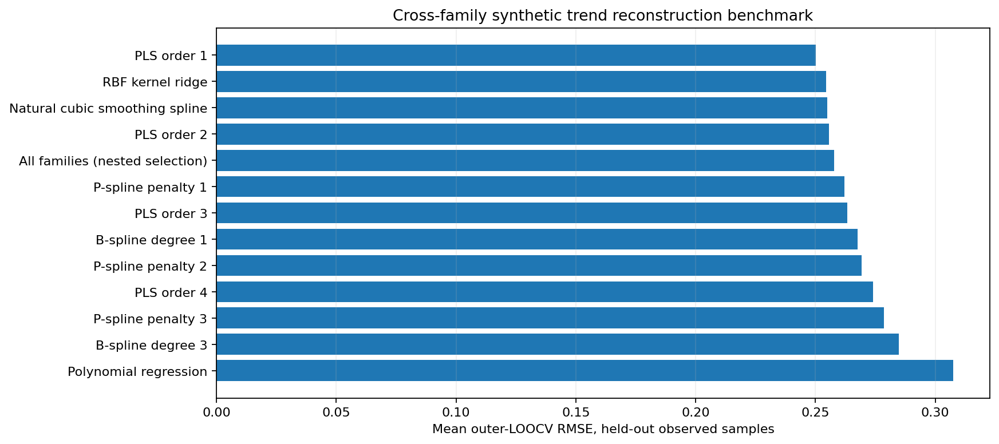
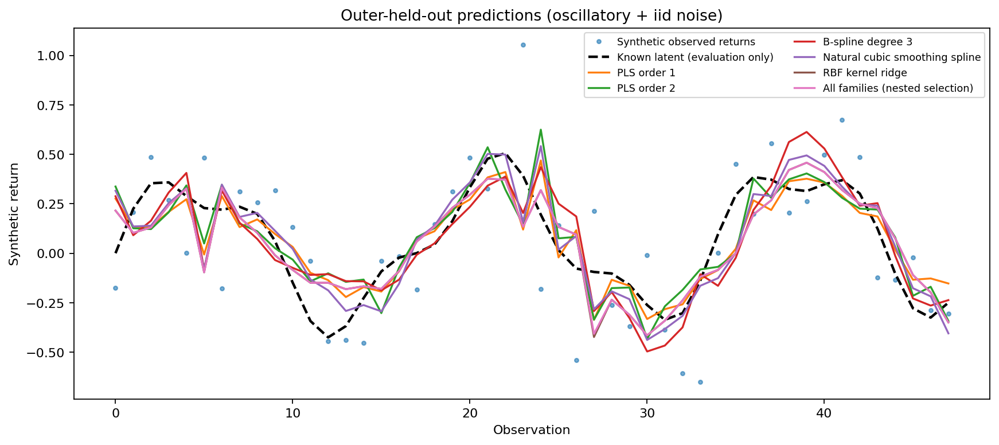
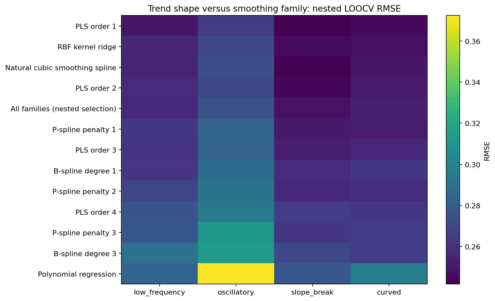

# EXP-004 — Cross-family smoothing and spline comparison

**Status:** planned protocol; executable results and figure links are appended only when produced.

## Research question

Which functional estimator reconstructs a held-out observation best under matched synthetic signals, and does the winner depend on the signal's shape and serial noise? This is *not yet* a comparison of downstream Hilbert-space market-regime detection, nor a chronological out-of-time forecasting benchmark.

**Relationship to EXP-003:** EXP-003 retains the Guerrero/variance-ratio Gaussian profile ML comparator, fixed smoothness and GCV. EXP-004 uses nested inner LOOCV for *every* candidate family, including PLS, so differences across families are not conflated with different selection rules. Its PLS scores are not claimed to be the EXP-003 Gaussian ML scores.

## Mathematics

Let observed measurements be $y_i=m(t_i)+\epsilon_i$. We compare penalized linear smoothers $\widehat m=Hy$, where $H$ is symmetric and fixed conditional on hyperparameters, the observation grid and basis.

- **Guerrero/Whittaker PLS** (zero reference difference mean): $H_{d,\lambda}=(I+\lambda D_d^\top D_d)^{-1}$ for $d\in\{1,2,3,4\}$, with $\lambda$ indexed by Guerrero's normalized $S$.
- **Regression B-splines**: $H=B(B^\top B)^{-1}B^\top$ for linear/cubic degree and several fixed knot counts.
- **P-splines**: $H=B(B^\top B+\lambda D_q^\top D_q)^{-1}B^\top$, applying an order-$q$ coefficient-difference penalty to cubic B-splines.
- **Natural cubic smoothing spline**: $H=(I+\lambda Q R^{-1}Q^\top)^{-1}$ with $Q$ the consecutive second-difference design and $R$ the natural cubic interpolation roughness matrix. For unit grid spacing, $R$ has $2/3$ on its diagonal and $1/6$ on its first off-diagonals.
- **RBF kernel ridge**: $H=K(K+\alpha I)^{-1}$, $K_{ij}=\exp[-(t_i-t_j)^2/(2\ell^2)]$. This equals the fitted posterior mean of a zero-mean Gaussian process with fixed hyperparameters, **not** full Bayesian inference or MLE.
- **Polynomial regression**: orthogonal projection onto polynomials of degree 0–3.

**Fully nested LOOCV:** For every outer held-out $j$, choose tuning parameters using only $\{y_i:i\ne j\}$. For each candidate fixed symmetric linear smoother, denote $e=y-Hy$ and $A=I-H$. The exact two-observation deletion residuals for missing $(i,j)$ satisfy

$$
\begin{pmatrix}r_i\\r_j\end{pmatrix}=A_{\{i,j\},\{i,j\}}^{-1}\begin{pmatrix}e_i\\e_j\end{pmatrix},
\quad
\widehat\theta_{-j}=\arg\min_{\theta}\frac1{n-1}\sum_{i\ne j} r_i(\theta\mid -j)^2.
$$

With $\widehat\theta_{-j}$ selected, score the outer held-out prediction by $r_j=e_j/(1-H_{jj})$. Each family is evaluated at exactly the same missing indices. The separate **All families (nested selection)** row selects across method families *inside* the same inner loop: it is not a post-hoc winner selected from outer test RMSEs.

The $A$ identity holds for these fixed-quadratic estimators with frozen smoothing structure; it **does not generally justify** a convenient nested deletion shortcut for Guerrero's data-dependent plug-in mean, LOESS, hyperparameters selected on full data, or adaptively chosen knots. Such cases need explicit refits and tests.

## Tested synthetic data / limits

Four signal shapes (low frequency, oscillatory, slope break and curved) × iid and AR(1) noise, from EXP-003, with independent seeds. The loss $\operatorname{RMSE}_{\mathrm{outer}}=\sqrt{n^{-1}\sum_j[y_j-\widehat m_{-j}(t_j)]^2}$ is an **interpolation/reconstruction** measure. The oracle latent RMSE $\sqrt{n^{-1}\sum_j[m(t_j)-\widehat m_{-j}(t_j)]^2}$ is reported *after predictions* and not used for tuning. Per-seed uncertainty is more defensible than falsely treating each overlapping fold as independent.

Selection grids are predeclared in `src/market_geometry/method_comparison.py`; unbalanced family search counts and the possibility of overfitting within the global inner selector require explicit sensitivity analysis. Retain negative results and seed-level scores. Results on real financial returns must also include chrono-forward forecasting, strong AR/lag-correlation/spectral baselines, and downstream networks before publication claims.

## Figure plan

| Figure | Interpretation |
|---|---|
| `all_families_outer_rmse.png` | Matched outer-LOOCV family ranking |
| `outer_predictions_gallery.png` | Held-out predictions of major estimator families on the same noisy series |
| `scenario_rmse_heatmap.png` | Sensitivity to latent trend shape |

Only append real image references after an archived run exists.

## Candidate additions

1. LOESS/local polynomial regression with explicit training-only neighborhood fitting and nested deletion.
2. $\ell_1$ trend filtering (Tibshirani 2014) and robust Huber penalties for sudden jumps / outliers.
3. Kalman local-level and local-linear state-space estimation, with likelihood tuned on training subsets and forecasting validation.
4. Wavelets for multi-scale changes, avoiding whole-series leakage in forward forecast comparisons.
5. Genuine rolling market-regime experiment comparing functional distances, Pearson, lagged correlation, coherence and other spectral baselines.

## Sources

- Guerrero (2007), *Time series smoothing by penalized least squares*, [DOI:10.1016/j.spl.2007.03.006](https://doi.org/10.1016/j.spl.2007.03.006).
- Eilers and Marx (1996), *Flexible Smoothing with B-splines and Penalties*, [DOI:10.1214/ss/1038425655](https://doi.org/10.1214/ss/1038425655).
- Tibshirani (2014), *Adaptive piecewise polynomial estimation via trend filtering*, [DOI:10.1214/13-AOS1189](https://doi.org/10.1214/13-AOS1189).

### Completed exploratory run `run_20261018T233840457599Z_s20261020_n6`

6 independent seeds × 4 trend shapes × 2 noise processes; n=48 equally-spaced samples. Observed outer LOOCV RMSE, with all hyperparameter selection nested.

| Method family | Outer-LOOCV RMSE |
|---|---:|
| PLS order 1 | 0.2496 |
| RBF kernel ridge | 0.2532 |
| PLS order 2 | 0.2545 |
| Natural cubic smoothing spline | 0.2551 |
| All families (nested selection) | 0.2558 |
| PLS order 3 | 0.2602 |
| P-spline penalty 1 | 0.2634 |
| B-spline degree 1 | 0.2652 |
| P-spline penalty 2 | 0.2684 |
| PLS order 4 | 0.2726 |
| P-spline penalty 3 | 0.2798 |
| B-spline degree 3 | 0.2871 |
| Polynomial regression | 0.3076 |

[Actual summary](../../results/004-cross_family_methods/runs/run_20261018T233840457599Z_s20261020_n6/summary.json) · [Seed-scenario scores](../../results/004-cross_family_methods/runs/run_20261018T233840457599Z_s20261020_n6/seed_scenario_level.csv) · [Held-out predictions](../../results/004-cross_family_methods/runs/run_20261018T233840457599Z_s20261020_n6/first_panel_outer_predictions.csv) · [SHA256](../../results/004-cross_family_methods/runs/run_20261018T233840457599Z_s20261020_n6/sha256_manifest.json)

**Limitations:** The experiment does NOT evaluate future forecasts, observed market returns, or market-regime networks. The oracle latent truth was used only in diagnostics. All other proposed method families remain untested.

### Completed exploratory run `run_20261018T233936318576Z_s20261020_n30`

30 independent seeds × 4 trend shapes × 2 noise processes; n=48 equally-spaced samples. Observed outer LOOCV RMSE, with all hyperparameter selection nested.

| Method family | Outer-LOOCV RMSE |
|---|---:|
| PLS order 1 | 0.2500 |
| RBF kernel ridge | 0.2545 |
| Natural cubic smoothing spline | 0.2549 |
| PLS order 2 | 0.2555 |
| All families (nested selection) | 0.2578 |
| P-spline penalty 1 | 0.2621 |
| PLS order 3 | 0.2632 |
| B-spline degree 1 | 0.2676 |
| P-spline penalty 2 | 0.2691 |
| PLS order 4 | 0.2740 |
| P-spline penalty 3 | 0.2786 |
| B-spline degree 3 | 0.2847 |
| Polynomial regression | 0.3074 |

[Actual summary](../../results/004-cross_family_methods/runs/run_20261018T233936318576Z_s20261020_n30/summary.json) · [Seed-scenario scores](../../results/004-cross_family_methods/runs/run_20261018T233936318576Z_s20261020_n30/seed_scenario_level.csv) · [Held-out predictions](../../results/004-cross_family_methods/runs/run_20261018T233936318576Z_s20261020_n30/first_panel_outer_predictions.csv) · [SHA256](../../results/004-cross_family_methods/runs/run_20261018T233936318576Z_s20261020_n30/sha256_manifest.json)

**Limitations:** The experiment does NOT evaluate future forecasts, observed market returns, or market-regime networks. The oracle latent truth was used only in diagnostics. All other proposed method families remain untested.
