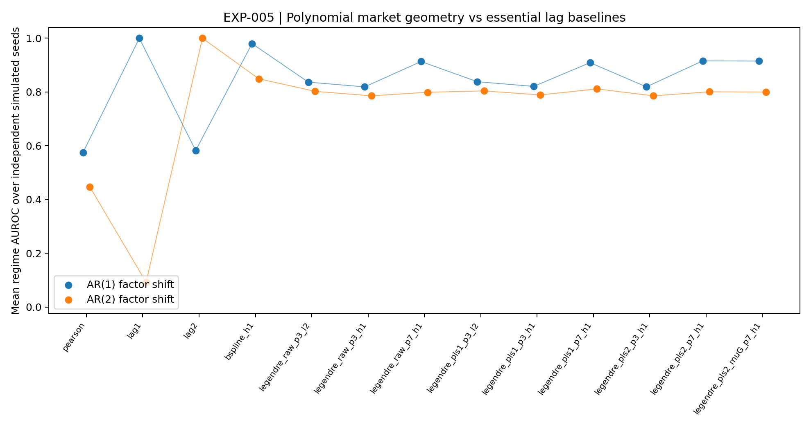
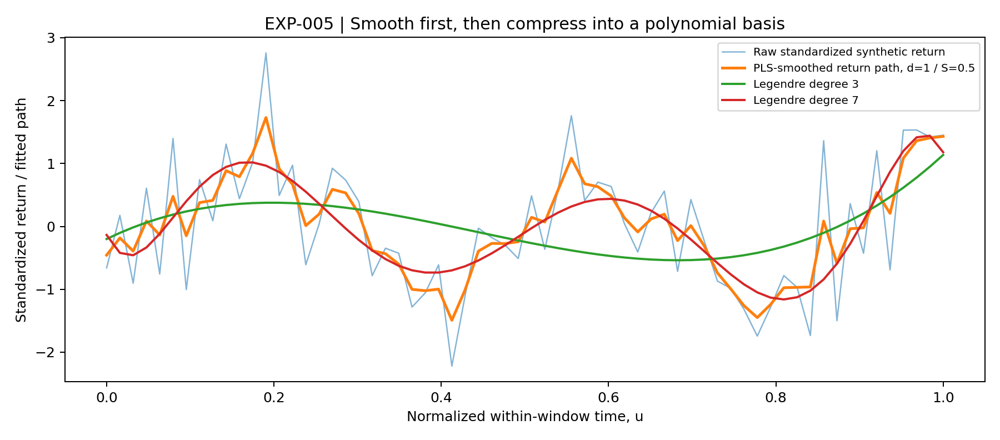
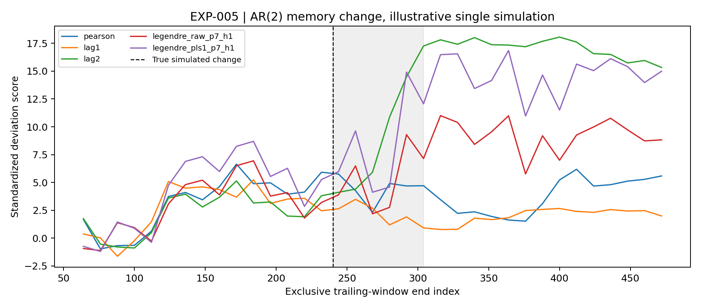

# EXP-005 — Orthogonal polynomial Hilbert geometry

**Status:** experimental method and protocol. Numerical outputs and actual figure embeds are appended after reproducible execution. **Not a confirmed mathematical novelty or a real-market result.**

## Question

Can an already estimated trend be compressed into a low-dimensional orthogonal-polynomial expansion without losing the market-network changes relevant to regime discrimination? Do derivative-aware distances help, relative to Pearson, cross-lag-1, cross-lag-2, and the uncompressed B-spline/Sobolev method from EXP-001?

EXP-004 evaluated polynomial regression as an estimator of noisy observations. **This experiment is different:** estimate the trend first (raw returns, PLS with order 1 or 2, and Guerrero's observed-mean difference plug-in), then project that trend onto a common orthonormal polynomial basis for geometry.

## Mathematical definitions

A trailing window contains $L$ synchronized return observations per stock, ending at time $T$, and is rescaled to $u\in[0,1]$. Let $\widetilde y_{i,T}$ be the per-window standardized return trajectory. The trend-estimation method $A$ produces $\widehat\tau_{i,T}^{A}(u)$.

Use normalized Legendre basis

$$
\phi_k(u)=\sqrt{2k+1}\,P_k(2u-1),\qquad
\int_0^1\phi_j(u)\phi_k(u)\,du=\delta_{jk}.
$$

Approximate the estimated trend by a degree-$p$ polynomial,

$$
\widehat f_{i,T}^{(p)}(u)=\sum_{k=0}^{p}a_{i,k,T}\phi_k(u).
$$

Coefficients are estimated by least squares **at the observed grid**. This is not numerically identical to continuous $L^2$ projection, but the *continuous distances between represented polynomials* below are evaluated exactly up to floating-point quadrature.

Since the basis is orthonormal, the polynomial-function $L^2$ distance satisfies

$$
d_{L^2}(i,j;T)^2=\int_0^1|\widehat f_i(u)-\widehat f_j(u)|^2\,du
=\sum_{k=0}^p (a_{i,k,T}-a_{j,k,T})^2.
$$

For the $H^1$ inner product (first-order Sobolev distance), with **normalized-window-time derivatives** and declared $\alpha\ge0$,

$$
\begin{aligned}
\langle f,g\rangle_{H^1_\alpha}
 &=\int_0^1 f(u)g(u)\,du+\alpha\int_0^1 f'(u)g'(u)\,du,\\
R^{(p)}_{jk}&=\int_0^1\phi'_j(u)\phi'_k(u)\,du,\\
d_{H^1_\alpha}(i,j;T)^2&=(a_i-a_j)^\top[I+\alpha R^{(p)}](a_i-a_j).
\end{aligned}
$$

The Gram matrix is strictly positive definite for $\alpha\ge0$. **Thus the distance is a metric on the represented polynomials**, but only a pseudometric on original noisy observations, because different trajectories may be projected onto the same polynomial. $R$ is obtained by Gauss–Legendre quadrature, exact for this polynomial integrand in exact arithmetic. Use one shared degree, basis and coordinate scaling for all assets within the comparison.

For an observed sequence of discrete return vectors standardized over $L$ time points, unweighted Euclidean distance is $\|z_i-z_j\|^2/L=2(1-\rho_{ij})$. Therefore simply using an unfiltered pointwise $L^2$ norm is **not** fundamentally different from contemporaneous Pearson correlation. Any extra contribution must come from representation, smoothing, derivatives, lags or other justified structure, and must beat strong conventional baselines.

### Trend smoothing before coefficient extraction

The fixed PLS references are

$$
\widehat\tau_{d,S}=H_{d,S}y,\qquad H_{d,\lambda}=(I+\lambda D_d^\top D_d)^{-1},\qquad
S(\lambda)=\frac{L-\operatorname{tr}(H_{d,\lambda})}{L-d}.
$$

Fixed $S=0.5$, $d=1,2$ in the initial experiment. A separate option uses the published Guerrero plug-in $\widehat\mu_G=(L-d)^{-1}\mathbf1^\top D_dy$ with $d=2$. These are **predeclared**, not selected by inspecting AUROC. We do not claim the parameter value is optimal.

**Hilbert-space caveat:** $\mathrm{span}\{\phi_0,\dots,\phi_p\}$ is a finite-dimensional Hilbert subspace of $L^2$ and of $H^1$; expanding polynomial coefficients does not establish a novel infinite-dimensional theorem.

## Protocol and two controlled synthetic regimes

1. Generate panels with 12 synthetic assets and 3 latent groups, independent by seed.
2. AR(1) memory change: group-factor lag-one autocorrelation changes sign, with stationary variance held at one. Original experiment with a strong lag-one baseline.
3. AR(2) memory change: $f_t=\phi f_{t-2}+\sqrt{1-\phi^2}\epsilon_t$, changing $\phi$ across the boundary. Within a stationary segment, lag-one correlation is zero; **lag-two correlation is an essential control.**
4. Fit each model using only returns in the trailing window. No future observations, no label-based hyperparameter tuning.
5. For each network/feature matrix, estimate a reference from **early pre-change windows only**. Score distance from that reference, then compute retrospective AUROC on later pre-change and post-change windows. Discard overlapping transition windows.
6. Compare Pearson distances; signed cross-lag-1 and cross-lag-2 features; B-spline/Sobolev; Legendre degrees $p=3,7$ from raw and PLS-filtered paths; $L^2$ and $H^1$ at $\alpha=0.01$. Plot actual trajectories, fitted polynomials and score histories.
7. Report paired differences at the level of independently seeded panels. Overlapping rolling windows do not constitute independent replications. An empirically selected winning model would require another holdout experiment.

**Metric-scaling limitation:** the EXP-001 B-spline metric differentiates in trading-day units, while this experiment’s polynomial $H^1$ differentiates in normalized window time. Their derivative weights are intentionally fixed rather than tuned to an equivalent common scale. A fair derivative-scale-matched ablation remains open.

**Critically, the reported metric is regime-discrimination AUROC**, not the observation-reconstruction LOOCV RMSE of EXP-004. Polynomial approximation error against the estimated trend, if explored, is a *compression* measure rather than a forecasting benchmark. The next experiment should use forward-in-time risk or regime targets and nested tuning without reusing test labels.

## Figure plan and reproduction status

| Planned figure | Scientific purpose |
|---|---|
| `regime_auroc_by_method.png` | Side-by-side AR(1) and AR(2) scores, including lag-2 baseline |
| `polynomial_trend_gallery.png` | Raw series vs PLS-smoothed trend vs Legendre degrees 3 and 7 |
| `lag2_regime_timeseries.png` | Temporal network deviation and the synthetic switch |

Run `python market_geometry/code/005-orthogonal_polynomial_geometry/run.py --quick --seeds 1` for an unarchived preflight; `--publish --seeds 8` creates immutable runs and embeds the actual PNG figures below.

## Literature and proximity to prior art

- Fernández-Palacín et al., 2025, *A Study of the Colombian Stock Market with Multivariate Functional Data Analysis*, [DOI:10.3390/math13050858](https://doi.org/10.3390/math13050858). Already applies spline-based Hilbert geometry and functional PCA/clustering in stock markets.
- Shackleton et al., 2024, *Comparing risk profiles of international stock markets as functional data: COVID-19 versus the global financial crisis*, [DOI:10.1002/asmb.2879](https://doi.org/10.1002/asmb.2879). Already studies functional derivatives in markets.
- Beyaztas et al., 2025, *Stock Return Prediction Based on a Functional Capital Asset Pricing Model*, [DOI:10.1002/for.3282](https://doi.org/10.1002/for.3282). Reviews polynomial, Fourier, spline and other functional bases.

This is established functional-data methodology. Whether any specific **new metric or diagnostic experiment** supplies a publishable contribution remains unresolved.

## Completed exploratory run `run_20261018T235420036338Z_n8`

Synthetic AR(1) and AR(2) memory switches; 8 independently seeded panels per DGP; 12 assets; 480 dates. No market data. All hyperparameters specified before reading the labels.

| Method | AR(1) AUROC | AR(2) AUROC |
|---|---:|---:|
| `pearson` | 0.575 | 0.448 |
| `lag1` | 1.000 | 0.092 |
| `lag2` | 0.583 | 1.000 |
| `bspline_h1` | 0.980 | 0.849 |
| `legendre_raw_p3_l2` | 0.837 | 0.802 |
| `legendre_raw_p3_h1` | 0.819 | 0.786 |
| `legendre_raw_p7_h1` | 0.913 | 0.799 |
| `legendre_pls1_p3_l2` | 0.838 | 0.804 |
| `legendre_pls1_p3_h1` | 0.821 | 0.789 |
| `legendre_pls1_p7_h1` | 0.909 | 0.812 |
| `legendre_pls2_p3_h1` | 0.819 | 0.786 |
| `legendre_pls2_p7_h1` | 0.916 | 0.801 |
| `legendre_pls2_muG_p7_h1` | 0.915 | 0.800 |

[Full per-seed scores](../../results/005-orthogonal_polynomial_geometry/runs/run_20261018T235420036338Z_n8/seed_method_auroc.csv) · [Summary and design](../../results/005-orthogonal_polynomial_geometry/runs/run_20261018T235420036338Z_n8/summary.json) · [SHA256 evidence](../../results/005-orthogonal_polynomial_geometry/runs/run_20261018T235420036338Z_n8/sha256_manifest.json)

**Interpretation:** This benchmark tests whether polynomial compression preserves usable changes in network shape. These AUROCs are not forecasts, and a winning score is not proof of novelty. Lag-two correlation is a crucial comparator in the AR(2) model.
