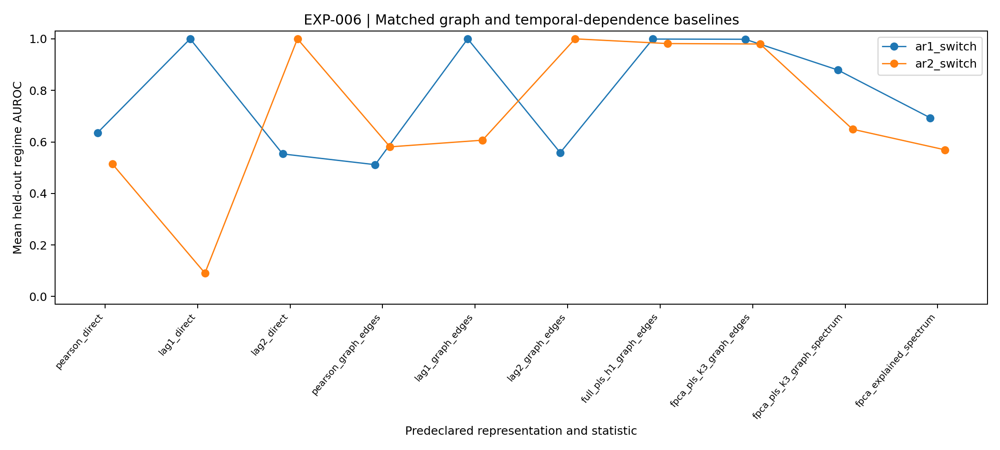
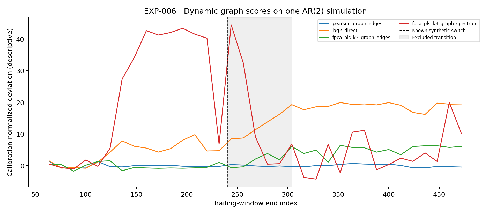
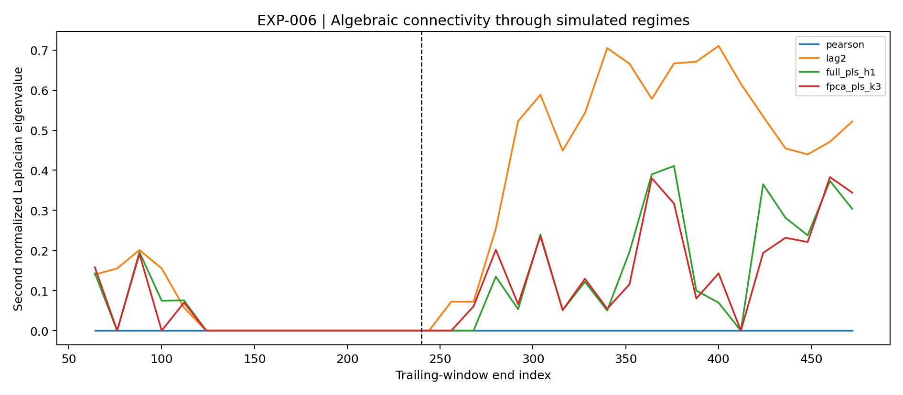
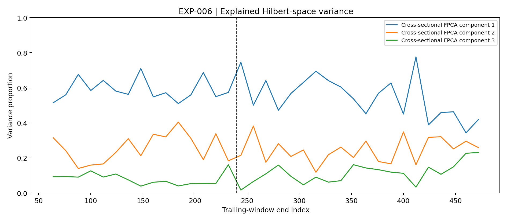
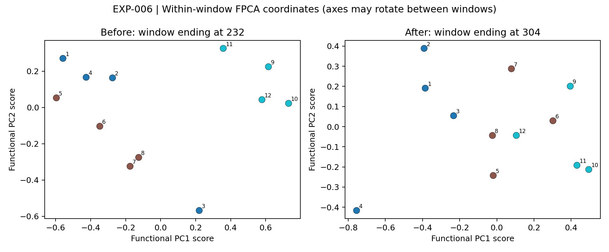
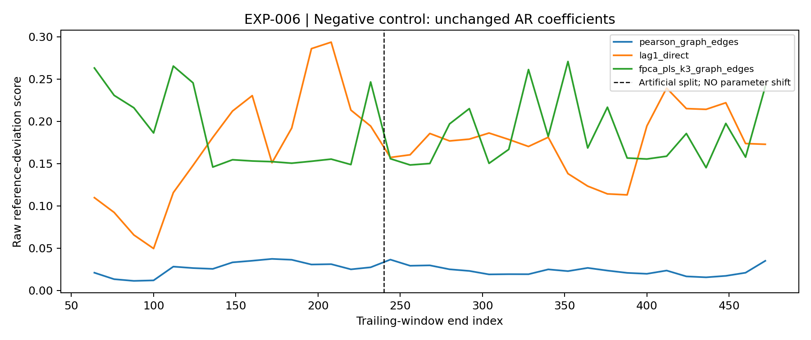

# EXP-006 — Window-local functional PCA and dynamic graph spectra

**Status:** an exploratory synthetic benchmark (results are appended below *only after* a successful archived run). This note is the canonical research record.

## Question and falsifiable hypothesis

Given functional representations of trailing-window standardized returns, does projection onto low-dimensional Hilbert-space principal directions and monitoring of kNN graph Laplacian eigenvalues discriminate AR memory changes better than Pearson or appropriately lagged cross-correlation networks? Null hypothesis: **no** incremental detection advantage beyond the strongest appropriate lag baseline. An actual research paper would need out-of-time value, not just a changed graph.

## Mathematics

Let $z_{i,w}\in\mathbb R^L$ be asset $i$'s standardized returns for window $w$. Smooth with first-difference PLS using fixed Guerrero-type $S=0.5$ and $\mu=0$; obtain an order-$7$ Legendre expansion $f_{i,w}(u)=\sum_{j=0}^7a_{ij,w}\phi_j(u)$ for $u\in[0,1]$. This is a discrete least-squares coefficient fit, not an exact continuous projection.

For $\alpha=0.01$ and derivative Gram matrix $R_{jk}=\int_0^1\phi_j'(u)\phi_k'(u)du$, define

$$
G=I+\alpha R,\qquad x_{i,w}=G^{1/2}a_{i,w},\qquad C_w=\frac1{n-1}\sum_{i=1}^n(x_{i,w}-\bar x_w)(x_{i,w}-\bar x_w)^\top.
$$

Implementation uses a Cholesky factor $G=LL^\top$ and row coordinates $a_{i,w}^\top L$; this yields the same inner product. Taking the leading $r=2,3,5$ eigenvectors $U_{r,w}$ of $C_w$, obtain asset PC coordinates and distances

$$
q_{i,w}^{(r)}=U_{r,w}^\top(x_{i,w}-\bar x_w),\quad
D_{ij,w}^{(r)}=\|q_{i,w}^{(r)}-q_{j,w}^{(r)}\|_2.
$$

In the actual implementation the sample PCA is computed by SVD; either representation is algebraically equivalent. Importantly, **functional PCA here is cross-sectional over the assets within each window**, not dynamic FPCA based on a long-run covariance operator. Its axes can rotate across windows. Distances are invariant to sign changes and within-eigenspace orthogonal rotations, so no invalid raw-PC-score differencing occurs.

For each distance matrix $D_w$, build an undirected union-$k$-nearest-neighbor graph ($k=3$) with weights

$$
W_{ij,w}=\mathbf 1\{i\text{ or }j\text{ selects the other}\}
\exp\left(-\frac{D_{ij,w}^2}{2h_0^2}\right),\qquad W_{ii,w}=0.
$$

Bandwidth $h_0$ is chosen as the median positive distance in **calibration windows only**. The symmetrized normalized Laplacian is

$$
\mathcal L_w=I-\operatorname{diag}(W_w\mathbf1)^{-1/2}W_w\operatorname{diag}(W_w\mathbf1)^{-1/2}.
$$

Monitor $\lambda_2(\mathcal L_w)$ (algebraic connectivity), all sorted eigenvalues, and the upper-triangular weighted adjacency. Score a feature sequence $v_w$ against a past calibration reference:

$$
s_w=\left[\frac1m\sum_{j=1}^m(v_{wj}-\bar v_{\mathrm{cal},j})^2\right]^{1/2}.
$$

Graph edge vectors preserve asset identities; spectra are invariant under vertex relabeling and necessarily discard information. The PLS polynomial distance is a pseudometric on raw observed series (different raw paths may share fitted polynomials).

## Predeclared design

- Three simulations: AR(1) factor coefficient flips from $0.75$ to $-0.65$; AR(2) factor coefficient flips similarly; a **null** AR(1) factor with unchanged coefficient $0.7$ across an artificial segment split. Factor variance and contemporaneous dependence are stable in population (edge effects from regime restart are excluded).
- 12 assets, three known groups used *only for figure coloring*, 480 steps, boundary 240, trailing windows 64, stride 12, eight independent seeds by default. Calibration ends in the first half of pre-switch period; scoring uses later clean pre and clean post windows, omitting boundary-straddling windows. No regime labels are used to fit FPCA, smoothing, bandwidth or graph parameters.
- Methods: Pearson, signed lag-1 and lag-2 symmetrized cross-correlation, full PLS polynomial Sobolev features, cross-sectional functional PCA from raw and smoothed coefficients with dimensions 2/3/5. Each has weighted graph edge and graph spectrum scores. Include **direct** Pearson/lag-1/lag-2 deviation scores, an essential check against a weaker graph-only baseline.
- AUROC is a retrospective discrimination score. Its use of the known change boundary for evaluation and exclusion makes this neither an unsupervised online detector nor an actionable advance warning. The null case receives no artificial regime-discrimination AUROC; descriptive threshold exceedances are only a diagnostic.
- Independent units are simulation seeds; rolling windows overlap. Do not interpret a five-window empirical 95th percentile as a statistically calibrated alarm rate.

## Figure plan

Figures are saved as **actual PNG and SVG** in the matching immutable experiment run; do not link any figures before generation:

| File stem | Intended evidence |
| --- | --- |
| `mean_regime_auroc` | Paired method-level synthetic discrimination |
| `dynamic_network_scores` | Window-by-window deviations around AR(2) switch |
| `laplacian_eigenvalue2` | Algebraic connectivity trajectories |
| `functional_pca_explained_variance` | Explained Hilbert-space variance over time |
| `asset_functional_pca_maps` | Before/after cross-sectional PC score scatter plots |
| `null_control_scores` | Negative control where underlying AR coefficient stays fixed |

## Observed exploratory outcomes

Eight independent simulated seeds per DGP were processed. These are averages of per-seed
retrospective AUROCs (not independently held-out tuned performance, not inference about markets):

| Predeclared score | AR(1) switch | AR(2) switch |
|---|---:|---:|
| Pearson weighted-graph edges | 0.512 | 0.581 |
| Full PLS polynomial H1 graph edges | 0.999 | 0.982 |
| Functional PCA (3 PCs) weighted-graph edges | 0.998 | 0.980 |
| Functional PCA (3 PCs) graph spectrum | 0.879 | 0.649 |
| Direct lag-1 cross-correlation | 1.000 | 0.091 |
| Direct lag-2 cross-correlation | 0.553 | 1.000 |

The matching direct signed lag baseline is **1.000 in both cases** (lag-1 for AR(1),
lag-2 for AR(2)). The functional graph nearly matches it but is not superior.
The compressed three-component method tracks the full PLS representation closely,
while the sorted Laplacian spectrum discards more information, especially for AR(2).
These observations are conditional on the **predeclared** synthetic mechanisms,
fixed graph parameters, and retrospective exclusion of transition windows.

### Negative-control diagnostic (not a test of significance)

With no AR coefficient change, the mean fraction of post-split windows whose graph-
edge deviation exceeded the empirical 95th percentile of the **very small, overlapping**
calibration sample was:

- `pearson_graph_edges`: **0.708**.
- `fpca_pls_k3_graph_edges`: **0.408**.
- `lag1_direct`: **0.833**.

These fractions are far from a nominal 5% rate. There are few correlated windows,
finite-sample distribution shift, and a factor restart at the synthetic split even
when its AR coefficient is unchanged. This result is **not** a calibrated false-
alarm study. An operational detector needs rolling training-only thresholds,
null calibration, block dependence adjustment, and independent data.

## Closest related research — not a novelty claim

- [*Analysis of non-stationary dynamics in the financial system* (2014)](https://doi.org/10.1016/j.econlet.2013.09.026) describes moving-window fPCA and financial instability.
- [*Dynamical analysis of financial stocks network: Improving forecasting using network properties* (2025)](https://doi.org/10.1371/journal.pone.0319985) analyzes dynamic network statistics and financial market relations.
- [Nobi and Lee (2016), *State and group dynamics of world stock market by principal component analysis*](https://ideas.repec.org/a/eee/phsmap/v450y2016icp85-94.html) studies evolving cross-correlation principal components.

Sources are linked, not copied into the repository. Their methods need a detailed
text-level novelty audit before developing a publishable claim.

## Interpretations, ablations, and limitations

A claimed new effect must survive comparison with direct lagged-correlation scores and suitable spectral/coherence statistics, not merely beat Pearson. Fixed $k$, $S$, $\alpha$, polynomial degree, window and PC dimensions are not optimized here. Changing any such parameter after seeing these results creates exploratory tuning and demands fresh outer validation. Weighted kNN topology and normalized-Laplacian eigenvalues are neither causal-dependence estimates nor financial-return forecasts.

**Next study:** forward-chaining stock-return data, temporally fixed universe, absent/missing/adjusted prices audited, external market regime labels, risk targets, training-only tuning and test-block bootstrap. The existing multivariate functional-network literature and pre-existing moving-window financial FPCA invalidate any easy claim to novelty.

## Actual archived run: `run_20261019T011550419859Z_n8`

- Independent simulation seeds: **8**. Synthetic examples only.
- Full metrics: [aggregate CSV](../../results/006-functional_pca_graphs/runs/run_20261019T011550419859Z_n8/mean_metrics.csv); [per-seed CSV](../../results/006-functional_pca_graphs/runs/run_20261019T011550419859Z_n8/seed_method_metrics.csv); [manifest](../../results/006-functional_pca_graphs/runs/run_20261019T011550419859Z_n8/sha256_manifest.json).

