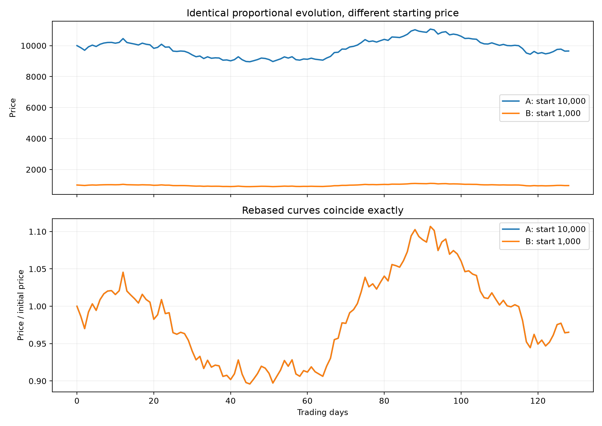
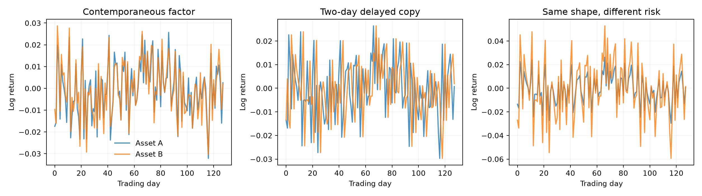
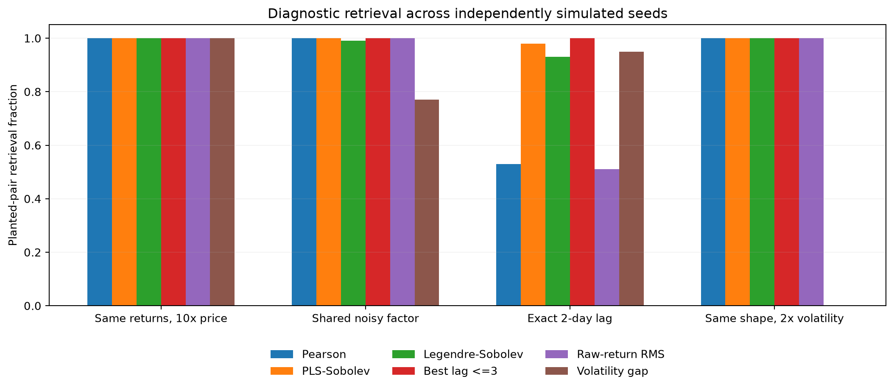

# EXP-007 — Define similarity targets before fitting market geometry

**Status:** synthetic research design with a reproducible 100-seed runner. The remote GitHub archive is generated separately; do not claim an archived run until its CSV, manifest and figures exist. This is a controlled diagnostic rather than empirical stock-price evidence.

## Question and theory

Which properties of two asset price series should a Hilbert-space representation consider the same? Distinguish *relative price shape*, *contemporaneous dependence*, *delayed dependence*, and *volatility/risk*.

Generate daily log returns $r_{i,t}$ and prices

$$
P_{i,t}=p_i\exp\left(\sum_{s=1}^t r_{i,s}\right),\quad p_i>0.
$$

When $p_A=10000$, $p_B=1000$, and $r_{A,t}=r_{B,t}$, then $P_{A,t}=10P_{B,t}$. Hence raw-price distance is positive, whereas rebased-price distance and log-return distance vanish identically.

For standardized paths $z_i$, Pearson correlation distance satisfies

$$
D_{\rho}(i,j)=\sqrt{2(1-\widehat\rho_{ij})}
=\sqrt{T^{-1}\|z_i-z_j\|_2^2}.
$$

Therefore standardized Euclidean distance adds no pairwise information beyond Pearson correlation. A functional representation may differ because smoothing and derivative penalties change what is retained.

Compare zero-mean finite-difference PLS ($d=1$, $S=0.5$), the discrete Sobolev distance with derivative weight $0.20$, and a degree-7 Legendre $H^1$ distance with derivative weight $0.01$. Lag comparison uses maximum **signed** correlation over shifts $-3,\ldots,3$; the induced dissimilarity need not obey the triangle inequality.

## Predeclared cases

| Case | Construction | Intended test |
|---|---|---|
| level_clone | Identical log returns, initial levels 10,000 vs 1,000 | Invariance to arbitrary multiplicative price level |
| shared_factor | Two assets share a Gaussian factor with independent noise | Contemporaneous co-movement recovery |
| lagged_factor | One asset follows another with exactly two days' delay | Retrieval of delayed relationships |
| volatility_clone | Asset B has twice asset A's returns | Distinguish equal normalized shape from equal risk |

All cases contain a third, independent comparison asset. Initial levels are 10,000, 1,000, and 3,500. Each panel has 128 returns. The original local development run used 100 independent seeds starting at 42000.

## Evaluation and safeguards

For planted pair A-B and decoy pair A-C, record whether $D(A,B)<D(A,C)$ and the normalized separation $(D(A,C)-D(A,B))/(D(A,C)+D(A,B))$. Aggregate at the **independent seed level**.

**The volatility case must not be judged by retrieval rate**: twofold-scaled returns have identical normalized shape but different volatility, so evaluate the volatility log ratio $\lvert\log(s_B/s_A)\rvert=\log 2$ instead. The exact clone is an invariant/unit test, not a substantive publication result.

This experiment uses iid Gaussian returns; it is not a realistic financial-market simulator. There is no forecasting, chronological holdout, time-varying covariance, heavy tails, or causal inference. No method is tuned on known pair labels.

## Reproduction

~~~powershell
python market_geometry/code/007-similarity_targets/run.py --quick
python market_geometry/code/007-similarity_targets/run.py --publish --seeds 100 --length 128 --seed-start 42000
python scripts/validate_research.py
~~~

The publishing command creates an immutable, timestamped pair of results and figures directories and appends the **actual** generated figures and numerical summaries below. Never add figure links before they exist.

## Figure plan and reproduction status

- price_level_invariance.png/.svg: raw and rebased prices.
- scenario_returns.png/.svg: contemporaneous factor, delayed relationship, and volatility example.
- target_retrieval.png/.svg: rates of retrieving the planted pair (volatility case is descriptive only).

## Follow-up design

After verifying these invariances, introduce common stochastic volatility, Student-t shocks, dynamic factor loadings, sector graphs and realistic observation noise. Evaluate recovered population dependence, graph errors, false alarms, detection delay, and out-of-time forecast risk. Compare DCC-GARCH, lagged cross-correlation and spectral/coherence networks.

## Literature

- Cont (2001), *Empirical properties of asset returns: stylized facts and statistical issues*, DOI 10.1080/713665670.
- Ramsay (2010), *Curve registration*, Oxford Handbook of Functional Data Analysis, DOI 10.1093/oxfordhb/9780199568444.013.9.
- Engle (2002), *Dynamic Conditional Correlation*, Journal of Business & Economic Statistics, DOI 10.1198/073500102288618487.
- Hyndman and Athanasopoulos, *Forecasting: Principles and Practice*, time-series cross-validation.

## Archived run: run_20261019T020150842748Z_s42000_n100

- 100 independent seeds, 128 observations per asset; start seed 42000. Synthetic iid Gaussian innovations.
- [Seed-level data](../../results/007-similarity_targets/runs/run_20261019T020150842748Z_s42000_n100/seed_level.csv); [aggregated scores](../../results/007-similarity_targets/runs/run_20261019T020150842748Z_s42000_n100/summary.csv).

### level_clone

| Method | Retrieval fraction | Mean normalized margin |
|---|---:|---:|
| raw_price_rms | 0.000 | -0.160 |
| rebased_price_rms | 1.000 | 1.000 |
| return_rms | 1.000 | 1.000 |
| pearson | 1.000 | 1.000 |
| pls_h1 | 1.000 | 1.000 |
| legendre_h1 | 1.000 | 1.000 |
| max_lag3_correlation | 1.000 | 1.000 |
| volatility_log_ratio | 1.000 | 1.000 |

### shared_factor

| Method | Retrieval fraction | Mean normalized margin |
|---|---:|---:|
| raw_price_rms | 0.000 | -0.159 |
| rebased_price_rms | 0.980 | 0.548 |
| return_rms | 1.000 | 0.556 |
| pearson | 1.000 | 0.563 |
| pls_h1 | 1.000 | 0.563 |
| legendre_h1 | 0.990 | 0.518 |
| max_lag3_correlation | 1.000 | 0.539 |
| volatility_log_ratio | 0.770 | 0.326 |

### lagged_factor

| Method | Retrieval fraction | Mean normalized margin |
|---|---:|---:|
| raw_price_rms | 0.000 | -0.160 |
| rebased_price_rms | 1.000 | 0.647 |
| return_rms | 0.510 | 0.002 |
| pearson | 0.530 | -0.001 |
| pls_h1 | 0.980 | 0.059 |
| legendre_h1 | 0.930 | 0.348 |
| max_lag3_correlation | 1.000 | 1.000 |
| volatility_log_ratio | 0.950 | 0.715 |

### volatility_clone

| Method | Retrieval fraction | Mean normalized margin |
|---|---:|---:|
| raw_price_rms | 0.000 | -0.158 |
| rebased_price_rms | 0.790 | 0.174 |
| return_rms | 1.000 | 0.175 |
| pearson | 1.000 | 1.000 |
| pls_h1 | 1.000 | 1.000 |
| legendre_h1 | 1.000 | 1.000 |
| max_lag3_correlation | 1.000 | 1.000 |
| volatility_log_ratio | 0.000 | -0.817 |

